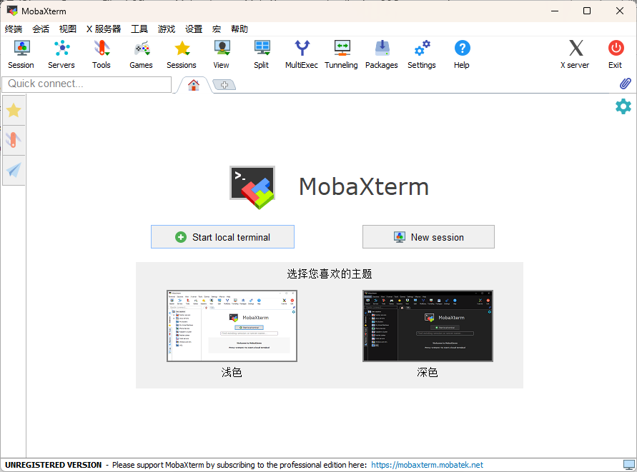

# MobaXterm Localization （MobaXterm 汉化和本地化翻译框架）

面向 MobaXterm Home Edition 的社区本地化构建框架：以官方英文程序为输入，读取独立语言词典，生成对应语言的程序副本。目前提供MobaXterm的中文汉化包

当前适配 **MobaXterm 26.5 / build 5542**，提供**简体中文发行包**。工具支持扩展其他语言；其他语言需要贡献者填写词典、自行构建与验证。

> 这是社区资源本地化项目，与 Mobatek 官方没有隶属关系。不提供注册、破解、功能解锁或授权绕过。



## 鸣谢

本项目参考并复用了 **[RipplePiam / MobaXterm-Chinese-Simplified](https://github.com/RipplePiam/MobaXterm-Chinese-Simplified)** 的 24.3 版本界面译文。感谢原作者对简体中文翻译、提示文字和界面本地化的长期投入。

因为工具已经更新到 26.5，这里补充新版文本，同时整理出可维护的词典、版本校验和多语言构建流程。

MobaXterm 本体由 [Mobatek](https://mobaxterm.mobatek.net/) 开发。有关软件及第三方译文的权利范围，见 [THIRD_PARTY_NOTICES.md](THIRD_PARTY_NOTICES.md)。

## 下载和使用中文发行版

在本仓库的 **Releases** 页面下载 `MobaXterm-Home-26.5-zh-CN-portable.zip`，解压到独立目录，然后运行 `MobaXterm_26.5_zh-CN.exe`。

发行 ZIP 包含中文程序、对应的官方 CygUtils 插件、构建报告、校验和及使用说明；

## 构建中文版本

要求：**Windows、Python 3.10 或以上**。只需要 Python 标准库。原版输入请自行从 [MobaXterm 官方下载页](https://mobaxterm.mobatek.net/download-home-edition.html) 获取。

以下命令均在项目根目录运行：

```powershell
# 将未修改的 26.5 原版程序放到 inputs/MobaXterm.exe
python tools/localize.py check --source inputs/MobaXterm.exe --locale zh-CN
python tools/localize.py build --source inputs/MobaXterm.exe --locale zh-CN --output build/zh-CN/MobaXterm_26.5_zh-CN.exe
```

构建只接受 [config/versions.json](config/versions.json) 中验证过的原版 SHA-256。输入文件名可以不同，但文件内容必须匹配。

## 新增语言和打包

```powershell
# 示例：生成独立日语词典；所有译文初始为空，空值保留原英文
python tools/localize.py init-language --source inputs/MobaXterm.exe --locale ja-JP --name "日本語" --output locales/ja-JP.json

# 编辑 locales/ja-JP.json 后，检查并构建
python tools/localize.py check --source inputs/MobaXterm.exe --locale ja-JP
python tools/localize.py build --source inputs/MobaXterm.exe --locale ja-JP --output build/ja-JP/MobaXterm_26.5_ja-JP.exe
```

这表示**按语言分别构建程序**，目前没有程序内即时切换语言的菜单。

完整教程：

- [新增语言：词典格式、上下文覆盖、占位符、验证与自行打包](docs/ADDING_LANGUAGES.md)
- [构建与版本适配：输入校验、输出报告、验证范围](docs/BUILDING.md)
- [贡献指南](CONTRIBUTING.md)

## 工程结构

```text
MobaXterm-Localization/
├── tools/                  # 提取、语言模板、检查、构建、中文发行打包
├── locales/                # 独立语言词典，当前提供 zh-CN
├── config/versions.json     # 已支持原版及插件的 SHA-256
├── docs/                   # 新增语言、构建、发布、已知问题
├── tests/                  # 语言隔离、资源格式、占位符回归检查
├── assets/                 # README 截图
├── inputs/                 # 用户自行放入原版，Git 忽略
└── release-assets/         # 默认发行产物目录，Git 忽略生成文件
```

## 当前状态

26.5 中文构建替换 **2,209 处**资源文本：其中 1,876 处为窗体/菜单/提示，333 处为字符串表条目。

构建会检查占位符、重新解析修改后的窗体，并验证所有非资源区段以及未指定修改的资源与原版逐字节一致。

汉化涉及可执行文件资源修改，因此生成程序不再拥有原厂有效数字签名。动态生成文字、输入框默认值、部分下拉选项和内嵌独立工具可能仍使用英文。更新到新的官方版本后必须重新适配，如果只改版本号或绕过校验会出现问题。

运行测试：

```powershell
python -B -m unittest discover -s tests -v
```

